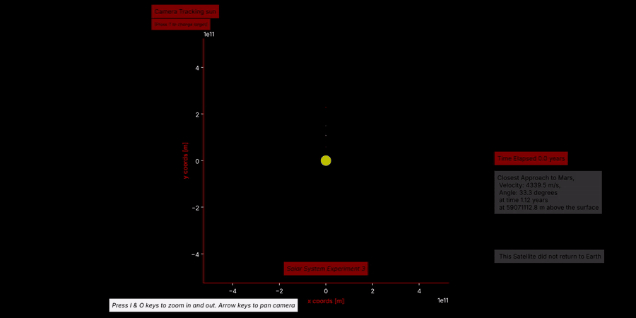

# Solar System N-Body Simulation

A 2D Newtonian simulation of the Sun and the eight planets, written in Python. Every body pulls on every other body (a full N-body problem, not fixed orbits). The motion is stepped forward with a choice of numerical integrators and shown in an interactive Matplotlib animation.



*Experiment 3, recorded from the program's own animation window. 26 satellites leave Earth over a spread of launch speeds and angles. The camera switches to Earth, then follows the closest satellite (4339.5 m/s at 33.3°) to its Mars flyby, 59,071 km above the surface after 1.11 years.*

## Experiments

Choose one from the menu when you run the program:

| # | Experiment | What it does |
|---|------------|--------------|
| 0 | Simulation | Runs and animates the full solar system |
| 1 | Orbital periods | Measures each planet's period from its simulated orbit and compares it with NASA values |
| 2 | Energy conservation | Tracks total energy (kinetic + gravitational potential) under Beeman, Euler-Cromer and direct Euler integration, and plots it over time |
| 3 | Satellite to Mars | Launches a grid of satellites from Earth over a range of speeds and angles, finds the one with the closest approach to Mars, and checks whether it returns to Earth |
| 4 | Planetary alignments | Counts how often the first *n* planets line up within a chosen angular tolerance |

## Physics and method

- **Gravity:** each body's acceleration is the sum of Newtonian gravitational pulls from all the other bodies, **a**ᵢ = Σⱼ G mⱼ (**r**ⱼ − **r**ᵢ) / |**r**ⱼ − **r**ᵢ|³.
- **Initial conditions:** planets start on the y-axis at their mean orbital radius, with circular-orbit speed v = √(GM☉ / r).
- **Integrators:**
  - **Beeman** (default): r(t+Δt) = r + vΔt + (Δt²/6)(4a − a_prev), v(t+Δt) = v + (Δt/6)(2a_next + 5a − a_prev)
  - **Euler-Cromer:** update the velocity, then the position using the new velocity
  - **Direct Euler:** update the position and velocity from the old values
- **Parameters** (masses, radii, orbital radii, colours, timestep, run length) are read from `parameters_solar.json`, so you can change the system without touching the code.

## Running it

Requires Python 3 with Tkinter (included in most Python installs).

```bash
pip install -r requirements.txt
python solar_system.py
```

Follow the text menu. The animation window is designed to be viewed full-screen.

### Controls in the animation

| Key | Action |
|-----|--------|
| `I` / `O` | Zoom in / out |
| Arrow keys | Pan |
| `T` | Change which body the camera tracks |

## Files

```
solar_system.py        simulation, experiments and animation
parameters_solar.json  body and run parameters
demo/                  demo GIF and video
```

## Author

Finlay McCormack
